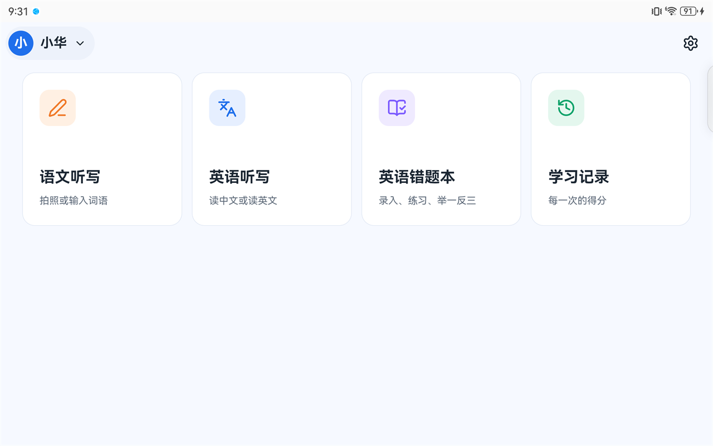
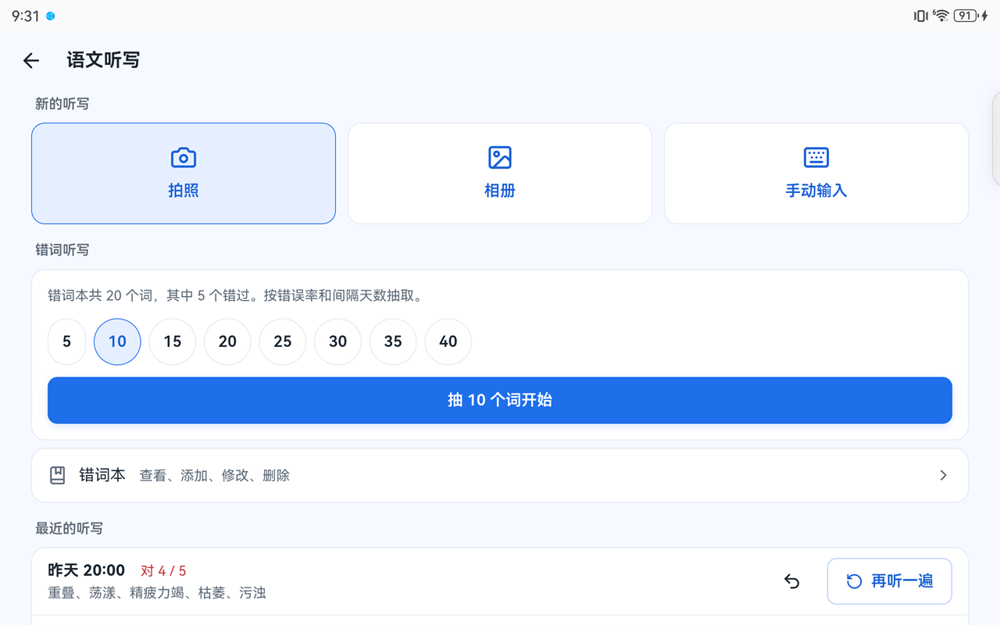
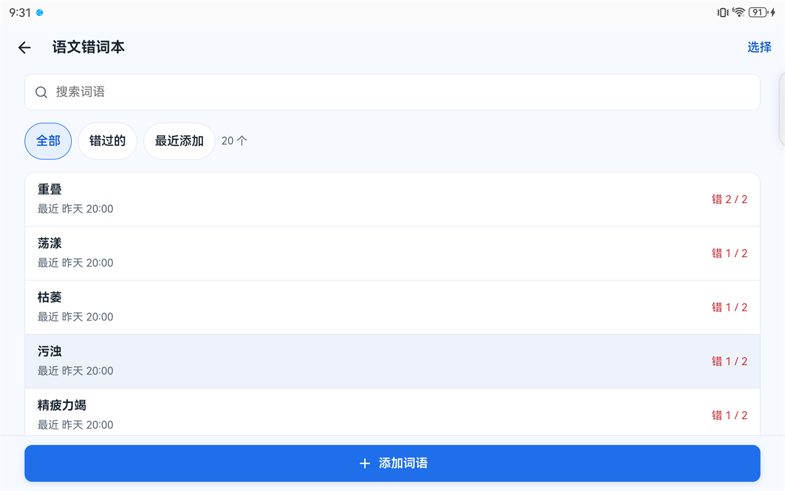
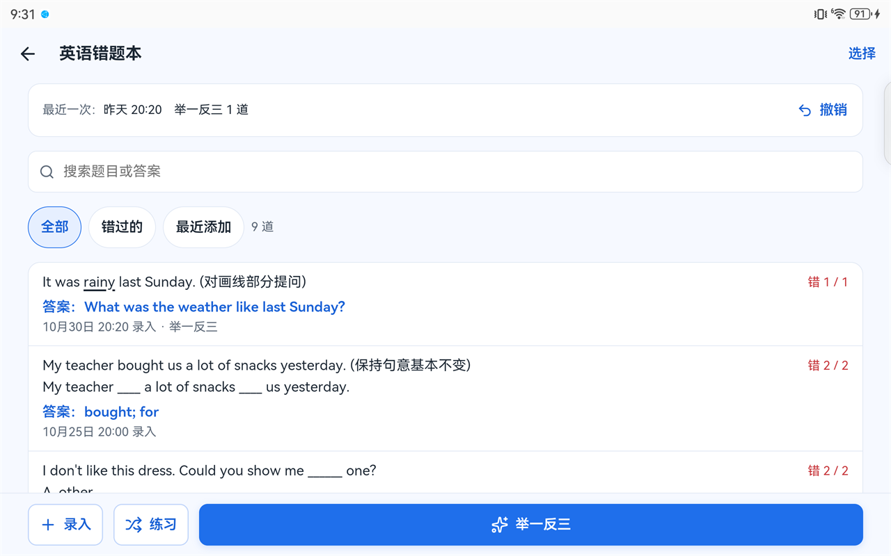
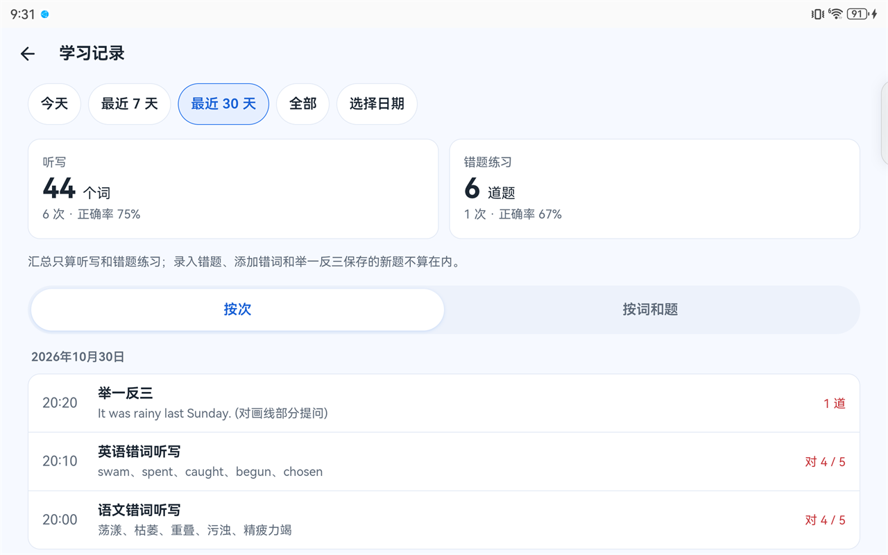

# 智能学习（Smart Study）

给小学生用的听写和英语错题练习 App。拍一张词语表或试卷，App 识别出词语和题目，朗读、计时、记录对错，再按错误率和间隔天数挑出需要复习的内容。适合在家里的安卓平板或手机上用。

截图里是示例孩子“小华”的数据，装好 App 后也可以先用它看看效果。

**语文听写**：拍照、相册或手动输入新词，也可以从错词本里抽词听写

**错词本**：每个词错了几次、最近什么时候听写过

**英语错题本**：画线的部分会标出来，可以练习，也可以举一反三

**学习记录**：按天查看每一次的得分，汇总正确率

## 能做什么

- **语文听写、英语听写**：拍照、从相册选图或手动输入词语，确认词表后打乱顺序，每个词读两遍，可以暂停或再读一遍。英语可以选“读中文写英文”或“读英文写英文”。写完后家长点选写错的词，提交保存。
- **错词本和错词听写**：所有听写过的词和它们的对错次数都在错词本里。错词听写按错误率和距上次的天数抽词，错得多、隔得久的优先。
- **英语错题本**：拍下试卷，App 识别题目并给出正确答案（不是照片上孩子写的答案），还能识别题目里画线的字母和单词。可以限时练习，也可以“举一反三”：让 App 照着错题出一道考同样知识点的新题。
- **学习记录**：按天查看每一次听写和练习的得分，按日期范围汇总正确率。录错了可以撤销。
- **多个孩子**：每个孩子的记录分开保存。

## 需要准备

- **一台安卓平板或手机**：Android 7.0 以上，系统的 Android System WebView 98 以上（大多数设备更新过系统就满足）。已在华为 MatePad 11（HarmonyOS 4.2）上使用。
- **一个千问 API Key**：拍照识别、翻译和举一反三要用阿里云的千问模型，每个人用自己的 Key。在[阿里云百炼控制台](https://bailian.console.aliyun.com/)右上角选择地域“华北2（北京）”，在“密钥管理”里创建 API Key。
- **费用**：按每天拍 2 张照片、翻译 20 个词、举一反三 10 道题估算，每月约 1.5–4.5 元，几乎都花在举一反三上（每道新题约 0.5–1.5 分钱）。
  - **不用举一反三的话，每月只要几毛钱**：同样每天拍 2 张、翻译 20 个词，每月约 0.2 元。拍照识别每张约 0.2–0.4 分钱（识别划线也算在内），照片多就按张数增加。
  - 手动输入的语文听写和已有题目的练习不调用千问，不花钱。

## 安装和第一次使用

1. 在 [Releases](https://github.com/beamind/smart-study/releases) 页面下载最新的 `smart-study-<版本>.apk`，在平板上打开安装。系统可能会提示“允许安装未知来源应用”。
2. 打开 App，按提示选择 **Documents** 文件夹，点“使用此文件夹”。App 会在里面建一个 `smartstudy` 文件夹存放数据。
3. 填写千问 API Key，也可以以后在“设置”里再填。
4. 输入孩子的名字开始使用，或者点“先看看示例（小华）”看看有记录时的样子。以后在首页点名字可以添加孩子、切换，或删除示例孩子。

## 数据和隐私

- **数据存在平板上**：所有记录保存在 `Documents/smartstudy` 文件夹里，卸载 App 不会丢失。重装后选择同一个文件夹，记录都还在。
- **可以找回**：每个数据文件都保留最近的历史版本，误删或改错后可以从 `data/history/` 找回。
- **换设备**：把整个 `smartstudy` 文件夹拷到新设备的 Documents 里，再在新设备上选择它即可。
- **发送给千问的内容**：只有拍照识别、翻译和举一反三会把照片或文字发送给阿里云千问。没有网络时，已有的词和题照常可以听写、练习和查看。
- **API Key**：只保存在这台设备的 App 里，不会写进数据文件夹。
- **没有其他上传**：App 没有账号系统，也不收集使用数据。

## 常见问题

- **识别错了怎么办？** 识别结果总要先确认：词语可以改、删、补，题目和答案可以点开修改，确认后才会保存。
- **华为设备上建不了 `smartstudy` 文件夹？** 先在文件管理里手动新建 `Documents/smartstudy`，再在 App 里选择这个文件夹。
- **电脑上能用吗？** 可以在电脑的 Chrome 或 Edge 里运行，选一个本地文件夹作为数据文件夹，例如从平板拷出来的 `smartstudy` 副本，见[开发说明](docs/development.md)。

## 参与开发

技术栈是 React + TypeScript + Vite，用 Capacitor 打包成 Android App。开发环境、测试、构建和目录结构见[开发说明](docs/development.md)；功能规则和数据格式见[软件说明](docs/software-plan.md)和[数据约定](docs/data-contract.md)。

## 许可证

[MIT](LICENSE)
